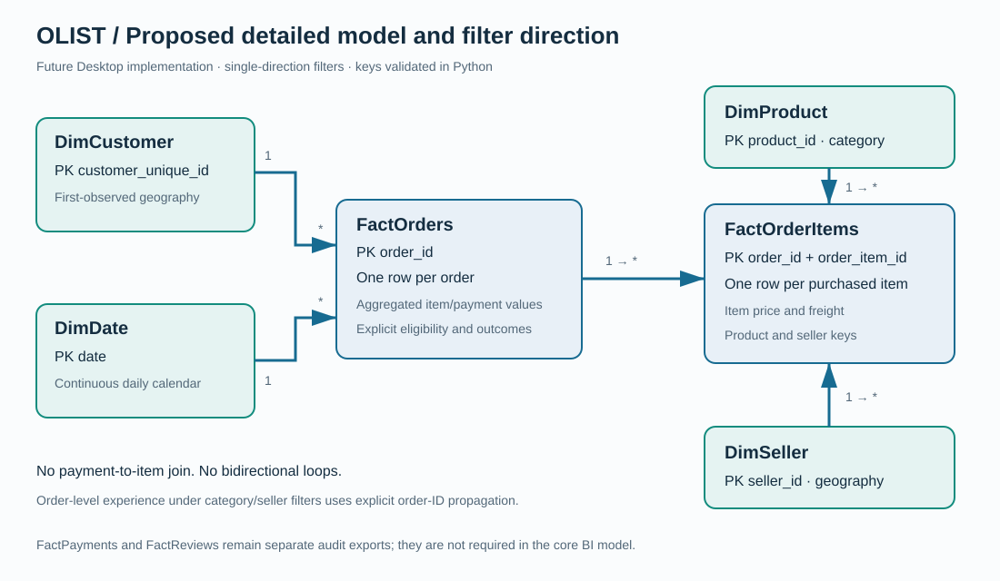
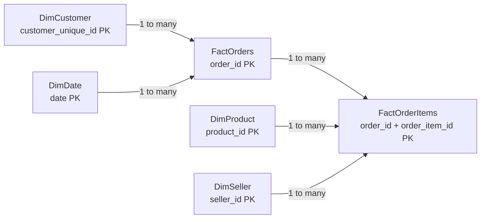

# Power BI implementation package

This folder contains a native Power BI report exported from Power BI Service, its month/state data snapshot, and the original four-page design package. The original star-schema DAX remains proposed and has not been validated in Power BI Desktop.

## Working Power BI dashboard

A native one-page report is now available: [Download Olist E-Commerce Performance.pbix](Olist%20E-Commerce%20Performance.pbix).

- [Open Power BI dashboard](https://app.powerbi.com/groups/me/dashboards/9b87c2c7-445f-4fb3-a60b-412b38d58a43?experience=power-bi)
- [Open interactive report](https://app.powerbi.com/groups/me/reports/2dce69d3-cc17-4a2b-8805-ce7d13ceb396?experience=power-bi)

Service links require an authorized Power BI account. The report was saved in My workspace and its page pinned live to **Olist E-Commerce Dashboard**. GitHub contains the downloadable report and its public-data snapshot; it does not host the Power BI service.

This implemented page contains GMV, delivered-order and unit cards, monthly merchandise GMV, customer-state GMV ranking and an interactive state dropdown. The four-page specification below remains a separate future expansion. Delivery/review fields are available in the summary dataset but are not visualized on this page.

### Source, reproduction and verification

`dashboard_data.csv` has 556 month/state rows, built from commercial-eligible FactOrders. Run `python run_pipeline.py --stage quality`, then `python powerbi/build_dashboard_data.py`. It is sourced from public Olist transactions already present in archive/. The report uses an anonymous CSV connection to this repository's raw dashboard_data.csv URL. No scheduled refresh was configured: regenerate and commit the CSV, then refresh the Power BI model when data changes.

All eight numeric columns are additive sums. GMV is delivered merchandise value, excluding freight; Orders is the number of eligible delivered orders; Units counts item rows. Returning_orders counts subsequent orders, not unique repeat customers. Delivery/review counts are restricted to this commercial population; they need not match separately defined marketplace-wide experience populations. Calculate rates as ratios of summed eligible counts, never averages of row rates. Unique customer counts cannot be reconstructed from this aggregate.

Validated total: **BRL 13,221,498.11**, **96,478 orders**, **110,197 units**. State filter AC (Acre): **BRL 15,930.97**, **80 orders**, **91 units**; Power BI cards matched the CSV. All six existing model tests passed. The downloaded PBIX was checked as a valid ZIP containing DataModel and five visual definitions. The business stage generated analytical tables and SQL checks but chart rendering stopped because matplotlib was absent; the dashboard export and existing tests completed independently.

Historical purchase window: September 2016 through August 2018. Boundary months and sparse early coverage should not be treated as comparable complete growth periods. The CSV omits months/states with no eligible orders; it is not a dense calendar table.

1. Run the pipeline and open Power BI Desktop.
2. Create a text parameter `OutputFolder` pointing to this project's `output` folder (ending in a path separator).
3. Use `import_tables.pq` as a function called `LoadOlist`. Create one query per required table: `= LoadOlist("FactOrders")`, etc.
4. Set the explicit data types described below; disable automatic relationship detection and create only the documented relationships.
5. Mark `DimDate[date]` as the date table, sort month names by month number and year-month by date, and import `theme.json`.
6. Add the measures in `dax_measures.md`, create the pages in `dashboard_specification.md`, and verify card values against `output/kpis.csv`.
7. Recheck a single-category and single-seller selection against `categories.csv` and `sellers.csv`. Those slicers need the explicit order-ID propagation measures; do not switch all relationships to bidirectional.

### Tables and relationships

| Table | Grain / primary key | Relationship | Direction |
|---|---|---|---|
| DimCustomer | One `customer_unique_id` | 1 → * FactOrders.customer_unique_id | Dimension to orders |
| DimDate | One `date` | 1 → * FactOrders.purchase_date | Dimension to orders |
| FactOrders | One `order_id` | 1 → * FactOrderItems.order_id | Orders to items |
| DimProduct | One `product_id` | 1 → * FactOrderItems.product_id | Dimension to items |
| DimSeller | One `seller_id` | 1 → * FactOrderItems.seller_id | Dimension to items |
| FactOrderItems | One (`order_id`, `order_item_id`) | Many-side of three relationships above | No outgoing filters |

Actual row counts and schemas are written to `output/model_inventory.csv`. This is a fact constellation with an order-header/detail relationship, resembling a star schema; it is not a single flat fact table. Avoid a second date/customer relationship into items, which would create redundant paths. FactPayments and FactReviews are audit outputs; keep them out of the initial BI model.

### Data types

Keep all IDs and ZIP prefixes as text. Use Date for purchase_date, first_purchase_date and DimDate.date; Date/Time for timestamp fields; Fixed Decimal Number for price/freight/payment/merchandise; Whole Number for item counts and date components. Use True/False for flags, preserving null `is_late` and `low_review`. Blank outcomes must not become false. `import_tables.pq` supplies these conversions for the main six tables.

For optional RFM and cluster slicers, merge `customers.csv` and `customer_clusters.csv` into DimCustomer by unique customer ID in Power Query. Keep the unique grain. These are full-window snapshot segments; they do not recompute as-of each historical month. Label them accordingly. Import cohort and 90-day result tables as disconnected snapshots and do not connect them to the daily date slicer without a separately designed cohort model.

Single-direction filtering and virtual propagation follow [Microsoft's relationship documentation](https://learn.microsoft.com/en-us/power-bi/transform-model/desktop-relationships-understand). `TREATAS` is used explicitly where item-level filters must restrict order-level experience measures.
